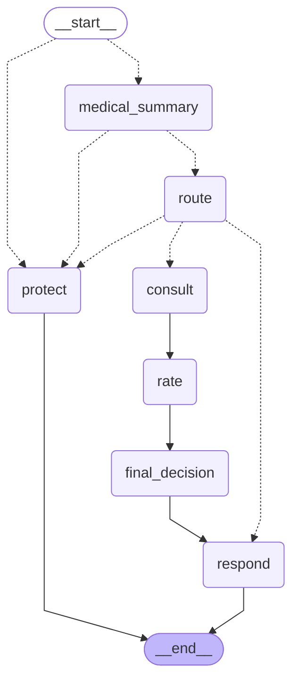

# Chat Quote Agent (Complex LangGraph)

The LangGraph implementation of the Chat Quote API main flow — a supervisor/orchestrator
in which a **main agent** drives the conversation and delegates every decision to
**single-purposed specialist tools**.

## Stack

- **Orchestration**: LangGraph (`StateGraph`, typed state, conditional edges)
- **Graph shape**: `understand → route → plan → consult → oversee → decide → respond`

## Set up local Dev environment

```bash
make install
```

## Main Flow Graph

